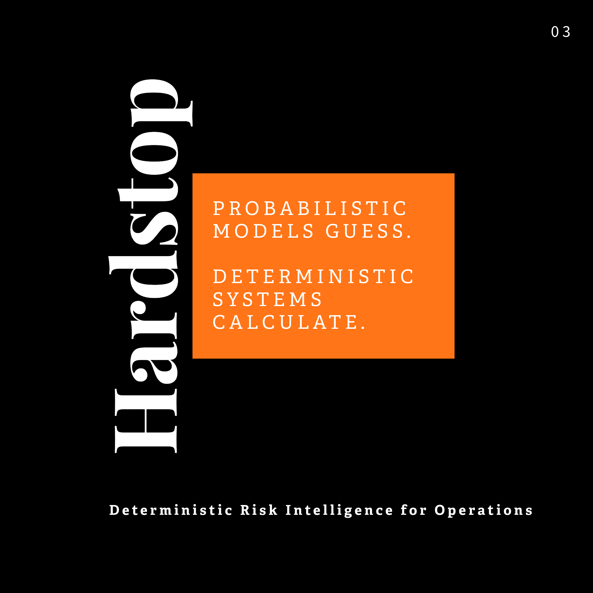

# Hardstop

Hardstop is a deterministic supply-chain risk engine. It monitors public alert sources (NWS, FDA, USCG, RSS feeds), links events to your operational network, and generates actionable risk briefs — all local, all auditable.

<p align="center">
  
</p>

## Why

Supply chain teams drown in alerts from dozens of sources. Hardstop filters the noise, scores impact against your actual facilities, lanes, and shipments, and produces daily briefs with clear classification: Interesting, Relevant, or Impactful. Same input always produces the same output.

## Quick Start

Use Python 3.11+ for the hashed environment below, which includes security tooling.
The application itself still supports Python 3.10; on 3.10, install the runtime
with `python -m pip install -e .` (or `-e ".[dev]"` for tests) instead of the
combined tooling lockfile. Run audits in a separate Python 3.11+ environment with
`python -m pip install -e ".[security]"`.

```bash
python -m venv .venv && source .venv/bin/activate   # Windows: .\.venv\Scripts\Activate.ps1
pip install --require-hashes -r requirements.lock.txt
pip install --no-deps -e .

hardstop init              # copy example configs
hardstop doctor            # verify environment
hardstop ingest            # load network data (facilities, lanes, shipments)
hardstop run --since 24h   # fetch + process events
hardstop brief --today --since 24h
```

## How It Works

1. **Fetch** — adapters pull from RSS/Atom, NWS Alerts API, FDA, USCG
2. **Filter** — configurable suppression rules drop noise (keyword, regex, exact match)
3. **Link** — events matched to your facilities, lanes, and shipments
4. **Score** — deterministic impact scoring with trust-tier weighting and quality validation
5. **Brief** — tier-aware daily summaries in markdown or JSON

## Key Commands

| Command | What it does |
|---------|-------------|
| `hardstop init` | Initialize Hardstop configuration files from examples |
| `hardstop doctor` | Run health checks on Hardstop system |
| `hardstop ingest` | Load network data from CSV files |
| `hardstop fetch` | Fetch items from external sources |
| `hardstop ingest-external` | Ingest external raw items into events and alerts |
| `hardstop run --since 24h` | Run full pipeline: fetch → ingest → brief |
| `hardstop brief --today` | Generate daily brief |
| `hardstop sources list` | List configured sources |
| `hardstop sources health` | Display source health table |
| `hardstop sources test <id>` | Test a single source by fetching |
| `hardstop incidents replay <id> [--strict] [--format json\|text]` | Replay an incident from artifacts |
| `hardstop export brief` | Export brief data |
| `hardstop export alerts [--tier] [--classification] --format csv` | Export alerts data |
| `hardstop export sources` | Export sources health data |
| `hardstop demo --mode pinned` | Run the demo pipeline |

Exit codes: **0** = healthy, **1** = warning, **2** = broken. Use `--strict` to fail on warnings.

## Configuration

- `config/sources.yaml` — external alert sources and tier settings
- `config/suppression.yaml` — noise filtering rules
- `hardstop.config.yaml` — quality thresholds and runtime settings

See [docs/CONFIGURATION.md](docs/CONFIGURATION.md) for the full reference.

## Design Principles

- **Local-first**: SQLite storage, no cloud dependencies
- **Deterministic**: strict mode guarantees identical inputs produce identical outputs
- **Self-evaluating**: exit codes and health checks surface problems, no silent failures
- **Auditable**: run records, config fingerprints, and artifact hashes for every execution. Alerts fail closed: an alert is not committed unless its incident evidence is written and hash-verified (PRs [#109](https://github.com/WhatsYourWhy/Hardstop/pull/109), [#114](https://github.com/WhatsYourWhy/Hardstop/pull/114)).

See [docs/ARCHITECTURE.md](docs/ARCHITECTURE.md) for the runtime specification.

## Project Structure

```
src/hardstop/
├── alerts/          # Alert generation, correlation, and impact scoring
├── api/             # Query surface for alerts, briefs, and sources
├── cli/             # CLI entrypoint and command handlers
├── config/          # Configuration loading and defaults
├── database/        # SQLite storage, schema, and migrations
├── ingestion/       # Local file / CSV network data ingestion
├── ops/             # Run records, status evaluation, artifacts
├── output/          # Brief generation and incident evidence
├── parsing/         # Event normalization and entity extraction
├── retrieval/       # Source adapters and fetching
├── runners/         # Executable workflows (demo, ingest, network load)
├── suppression/     # Noise filtering engine
└── utils/           # Shared IDs, logging, and time helpers
```

## Requirements

- Python 3.10+ for the application and tests; Python 3.11+ for security tooling
- CI runs the test suite on Python 3.10 and 3.12 on Linux and Windows
- `requirements.lock.txt` is a hashed lockfile generated on Python 3.12 with the `dev` and `security` extras
- SQLite (bundled with Python)

## Tests

```bash
pytest
```

Tests cover determinism regression, adapter parsing, alert quality validation, source health, suppression, and end-to-end pipeline verification.

## Documentation

- [Architecture](docs/ARCHITECTURE.md) — runtime spec, operator taxonomy, determinism contract
- [Roadmap](docs/ROADMAP.md) — what is next, what is deferred, and why
- [Configuration](docs/CONFIGURATION.md) — sources, suppression, quality thresholds
- [CSV Contract](docs/CSV_CONTRACT.md) — network data format for facilities, lanes, shipments
- [Integrations](docs/INTEGRATIONS.md) — Slack, CI/CD, and agent integration patterns
- [Specs](docs/specs/) — run-record schema, canonicalization, export format

## License

[Hardstop Business License (SBL-1.0)](LICENSE). Shank Strategy Ops LLC is HARDSTOP's licensor and commercial contracting entity. WhatsYourWhy is the developer/GitHub handle.

Non-Commercial Use is permitted subject to the license. Commercial Use, as defined in the license, requires a separate written agreement with Shank Strategy Ops LLC. Section 2.2 permits limited production evaluation for up to three internal users solely to validate fit, load test, or evaluate functionality, provided no resulting data or insights are sold, bartered, or incorporated into a revenue-producing workflow. This version becomes available under Apache 2.0, in addition to SBL-1.0, on January 1, 2029. See [docs/LICENSING.md](docs/LICENSING.md) for details.

## Changelog

See [CHANGELOG.md](CHANGELOG.md) for version history.
